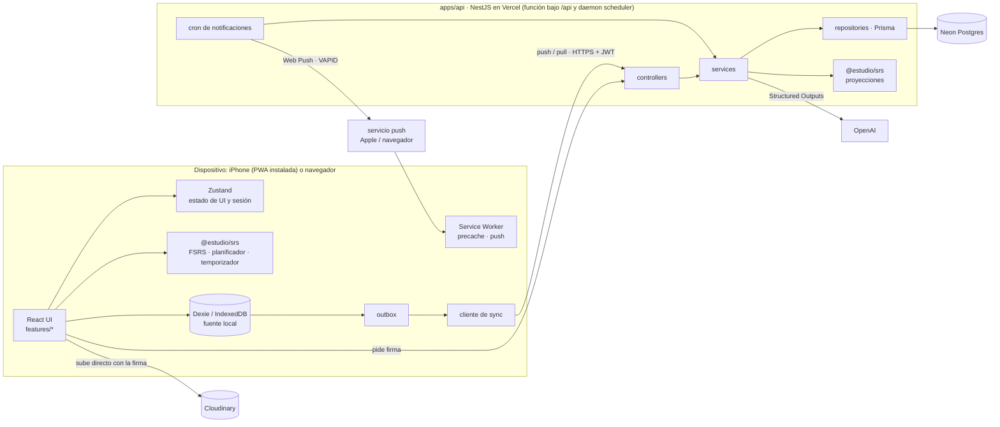
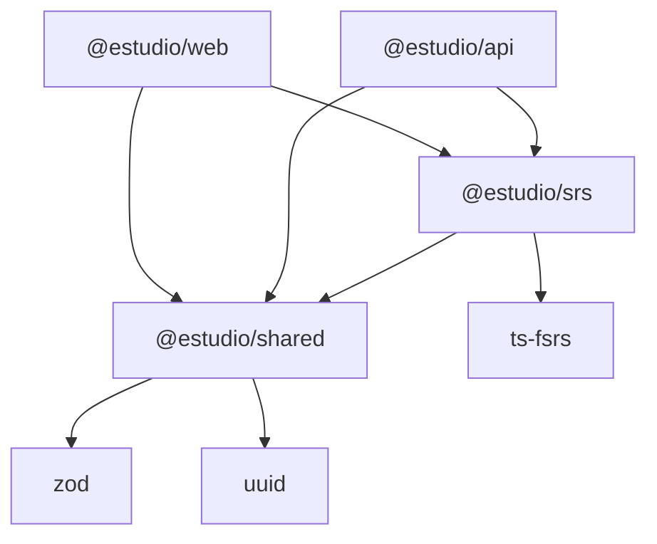

# ARCHITECTURE.md — estudio

**Precedencia:** [STUDY-METHODS.md](STUDY-METHODS.md) gana sobre este documento. Aquí se definen límites, flujos y decisiones; las reglas de estudio se citan por número.

## 1. Vista de ejecución



## 2. Paquetes y dependencias permitidas



| Paquete | Contiene | NO DEBE importar |
|---|---|---|
| `shared` | esquemas zod (entidades, contratos HTTP y sync), HLC, `ENTITY_STRATEGY`, esquemas de configuración (`StudyConfig`, `NotificationPrefs`, `GamificationConfig`), `CONTRACT_VERSION` | React, Nest, Dexie, Prisma, ts-fsrs, APIs de DOM o Node |
| `srs` | `replay()`, `buildSessionQueue()`, planificador P1-P8, máquina del temporizador §3, `toRating()`, métricas §5, gamificación, `decideNotification()` | DOM, Node, Dexie, `fetch`, reloj o azar propios (AGENTS AG3) |
| `web` | features, Dexie, outbox, service worker | `apps/api`, Prisma, secretos |
| `api` | módulos Nest, Prisma, cron, integraciones | `apps/web`, Dexie |
| `config` | tsconfig, ESLint, Prettier (solo `devDependency`) | código de runtime |

## 3. Flujos de datos

1. **Repaso (offline).** Intento (R1) → revelar → respuesta y explicación (R4) → calificación. Una transacción Dexie inserta el `ReviewLog`, actualiza la proyección `cardState` y encola en `outbox` (R3). Sin red no se pierde nada.
2. **Sync.** El cliente envía el outbox por lotes con `mutationId`. La API aplica todo en una transacción bajo `pg_advisory_xact_lock(user)`, asigna `server_seq` y confirma. Luego el cliente hace pull desde su cursor y vuelve a ejecutar `replay()` sobre las tarjetas afectadas. Detalle en SYNC.md.
3. **Media.** `POST /media/signature` → subida directa a Cloudinary → entidad `MediaAsset` (`publicId`, `version`) que se sincroniza como cualquier otra. Sin red, el blob espera en IndexedDB hasta poder subirse.
4. **IA (solo con red).** `POST /ai/drafts` → cuota diaria → OpenAI con JSON Schema estricto → validación zod → `AiDraft` en estado `draft` (sincronizado). Solo se convierte en tarjeta o ejercicio cuando ella lo acepta.
5. **Notificaciones.** El cron calcula pendientes por tema con `srs` sobre las proyecciones del servidor y aplica la política de §3 (`decideNotification`, función pura). Envía Web Push y registra `NotificationEvent`; el service worker reporta si se abrió.
6. **Temporizador.** Hay una `TimerSession` activa por cuenta. Su estado `{state, startedAt, pausedMs, blockIndex, plannedMs}` lo valida la máquina de `srs`, y el tiempo restante sale de marcas de tiempo (§3).

## 4. Reglas

**ARC1 · DEBE** respetar el grafo de §2, verificado con reglas `no-restricted-imports` por paquete (`eslint.config.js` de cada uno, sobre `packages/config/eslint`) y pnpm sin hoisting (prohibido `shamefully-hoist`). *Razón:* `shared` y `srs` corren en navegador y en Node; importar Nest o Dexie los rompe en uno de los dos.
```ts
// ❌ packages/shared/src/note.ts
import type { Note } from '@prisma/client';
// ✅ packages/shared/src/note.ts
export const NoteSchema = z.object({ id: z.uuid(), deckId: z.uuid(), kind: NoteKindSchema /* … */ });
```

**ARC2 · DEBE** implementar cola, planificador (P1-P8), temporizador (§3) y mapeo de calificaciones (P7) en `@estudio/srs`; web y api solo lo llaman. **NO DEBE** haber lógica de estudio en componentes React ni en services de Nest. *Razón:* sin red tiene que correr en el cliente, y el cron necesita los mismos números.
```ts
// ❌ const queue = cards.filter((c) => c.due <= now).slice(0, 10);
// ✅ const queue = buildSessionQueue({ cardStates, logs, config, now, budgetMs });
```

**ARC3 · DEBE** leer los datos de estudio en la UI desde Dexie; la red solo se usa para sync, auth, firma de media, IA y suscripción push. *Razón:* local-first, y tiene que funcionar sin señal.
```ts
// ❌ const { data } = useQuery({ queryKey: ['due'], queryFn: () => api.get('/cards/due') });
// ✅ const due = useLiveQuery(() => db.cardStates.where('due').belowOrEqual(dayEnd).toArray(), [dayEnd]);
```

**ARC4 · NO DEBE** salir ningún tipo de Prisma de la capa repository; los services devuelven tipos de `@estudio/shared`. *Razón:* el contrato es zod, y cambiar una tabla no debe romper el cliente.

**ARC5 · DEBE** derivar el estado FSRS de cada tarjeta reproduciendo su `ReviewLog` con `srs.replay()`, en cliente y servidor. **NO DEBE** sincronizarlo como campo LWW. *Razón:* dos dispositivos sin conexión que repasan la misma tarjeta llegan al mismo estado sin perder repasos (R2, R3; ADR-003).

**ARC6 · DEBE** enviar `X-Estudio-Contract: <n>` en cada request; si `n < MIN_CONTRACT`, la API responde `426` y la PWA actualiza el service worker. *Razón:* una PWA en caché puede ejecutar código viejo durante semanas.
- Además de `MIN_CONTRACT` (env), la API exige `MIN_SAFE_CONTRACT` (`shared`): el contrato más viejo que escribe sin borrar datos. La sync es LWW por fila entera, así que un cliente que no conoce un campo nuevo de una entidad LWW o de una sección de `UserSettings` lo omite al editarla, el servidor pone el default y pisa lo que escribió otro dispositivo. Y como los esquemas de fila son estrictos, un cliente viejo tampoco puede leer en el pull una fila con una forma nueva, sea LWW o de solo inserción. Por eso cambiar la forma de una fila que viaja sube `CONTRACT_VERSION` y `MIN_SAFE_CONTRACT` al mismo número; la prueba `lww-fields.test.ts` guarda una huella de los campos de todas las filas que viajan y falla si cambian sin revisarlo. Queda un caso que esto no cubre: un cambio que ella hizo sin red con la versión vieja y que se envía después de actualizar.

**ARC7 · DEBE** ejecutar cada job del cron bajo `pg_try_advisory_lock(<jobKey>)` y salir si no obtiene el lock. *Razón:* un redeploy solapado o una segunda instancia duplicaría envíos y rompería el máximo de 2 al día (§3).

**ARC8 · NO DEBE** el cliente usar credenciales propias con terceros: Cloudinary solo con una firma de vida corta emitida por la API, y Web Push solo con la clave VAPID pública. *Razón:* secretos solo en el servidor (AGENTS §5).

**ARC9 · DEBE** leer `StudyConfig` desde `UserSettings` (sincronizada) y parsearla con su esquema antes de pasarla a `srs`; los `default()` del esquema son los valores iniciales de STUDY-METHODS. *Razón:* una sola fuente de umbrales para web, api y pruebas (AGENTS AG4).
```ts
// ❌ buildSessionQueue({ ..., config: { newPerSessionMax: 10 } });
// ✅ buildSessionQueue({ ..., config: StudyConfigSchema.parse(settings.study) });
```

## 5. Registro de decisiones (ADR)

| # | Decisión | Descartado | Por qué |
|---|---|---|---|
| 001 | Monorepo pnpm + Turborepo | Nx; repos separados | Nx sobra para 2 apps; con repos separados los contratos zod se desincronizan |
| 002 | **Prisma** (decisión del responsable) con `@prisma/adapter-pg` sobre el pooler de Neon; URL directa solo para migraciones | Drizzle, TypeORM, Kysely | Migraciones y cliente maduros que él domina. Costo: el upsert LWW y `server_seq` van en SQL propio con `$queryRaw` y `Prisma.sql` (`modules/sync/sql.ts`). TypedSQL no se usa: en Prisma 7.10 sigue en preview y `generate --sql` necesita una base viva, lo que rompe el CI |
| 003 | Estado FSRS = proyección del `ReviewLog` | LWW del estado; CRDT | LWW pierde repasos concurrentes; un CRDT es excesivo cuando el log ya es solo de inserción |
| 004 | LWW por entidad con reloj lógico híbrido (HLC) | LWW por campo; reloj de pared; hora del servidor | Por campo agrega metadatos para un caso raro; el reloj de pared falla con desfase entre iPhone y PC; la hora del servidor ordena por llegada, no por edición |
| 005 | Cursor = `server_seq` bigint por usuario, asignado bajo advisory lock transaccional | `updated_at` como cursor; `xmin`; replicación lógica | Los timestamps empatan o retroceden; `xmin` depende de detalles internos; la replicación necesita infraestructura |
| 006 | Una `TimerSession` activa por cuenta, con toma de control explícita (decisión) | Una por dispositivo | Con una por dispositivo, los bloques de P6 se cuentan doble y hay dos avisos de fin de descanso (§3) |
| 007 | `userId` en todas las tablas, registro cerrado por lista de correos (decisión) | Una sola cuenta sin `userId` | Migrar a varios usuarios después es caro; cuota de IA, carpeta de Cloudinary y lock de sync quedan por usuario |
| 008 | API en Railway, cron dentro del proceso (`@nestjs/schedule`). **Reemplazada por ADR-018** | Fly; Render; funciones de Vercel; cron externo | En Fly, el auto-stop de máquinas detiene el cron; el plan gratis de Render se duerme; las funciones no tienen proceso persistente; un cron externo agrega otro punto de falla |
| 009 | `exam.affectsScheduling = true` por defecto, configurable (confirmado por el responsable) | `false` | P7 lo deja abierto; un simulacro es una recuperación real, y con ADR-003 cambiar el valor es retroactivo |
| 010 | Subida firmada directa a Cloudinary | Pasar archivos por la API; S3 | La API no carga con ancho de banda ni timeouts; S3 no ofrece transformaciones de imagen, audio y video |
| 011 | OpenAI solo desde la API, JSON Schema estricto + zod, resultado como borrador | Llamada desde el cliente; JSON mode sin esquema | Expondría la clave; JSON mode no garantiza la forma |
| 012 | zod como única validación (`ZodPipe` en Nest) | class-validator | Duplicaría el contrato y cliente y servidor divergirían |
| 013 | UUIDv7 generado en el cliente | UUIDv4; IDs del servidor | v7 mantiene los índices B-tree ordenados; con IDs del servidor no se puede crear sin red |
| 014 | Vitest en todo el monorepo (Nest con SWC) | Jest en api | Un solo runner, una sola config y el mismo reloj falso |
| 015 | Dominio propio: `app.<dominio>` (Vercel) y `api.<dominio>` (Railway) (decisión). **Reemplazada por ADR-019** | Dominios por defecto de cada servicio; rewrite `/api/*` en Vercel | Con dominios distintos, Safari bloquea la cookie de refresh; el rewrite agrega un salto y ata la API a Vercel |
| 016 | Sin servicio externo de errores: la web manda errores sin contenido a `POST /diagnostics/errors`, y las alertas salen de `GET /health/checks/:token` vigilado por un monitor de disponibilidad | Sentry | Son datos personales de una sola persona; con una usuaria, el volumen no justifica otro proveedor |
| 017 | Volcado semanal cifrado con `age` como artifact privado de GitHub Actions (90 días) | Cloudflare R2; Backblaze B2; no tener volcado | No agrega cuentas ni servicios; la base de una usuaria pesa pocos MB |
| 018 | Web y API en un solo proyecto de Vercel con Services, en el plan Hobby: la API es una función y el cron (BE14) corre en el daemon `scheduler` (`Dockerfile.scheduler`, 1 GiB). Lo que antes vivía en memoria y deben ver todas las instancias pasa a Postgres: las muestras de QA8 (`health_sample`) y los límites de login y registro de BE12 (`auth_attempt`) (decisión; reemplaza ADR-008) | Railway (ADR-008); Vercel Cron Jobs; un cron externo | Un solo proveedor, un solo dominio y sin costo. Las funciones se pausan entre requests y no comparten memoria, así que el cron necesita un proceso continuo y lo compartido va a la base. Vercel Cron no alcanza: el fin de descanso pide unos ±30 s (NT4). Costo: los daemons están en beta, corren solo en producción (las previews no mandan avisos) y en Hobby tienen una cuota mensual; si se agota, Vercel los detiene hasta el mes siguiente y QA8 lo reporta como `cron_stale`. Los logs de Hobby duran 1 h |
| 019 | Un solo origen: la web en `/` y la API en `/api` (rewrites de servicio en `vercel.json`). Nest usa el prefijo `api` en todos lados y la cookie de refresh queda en `Path=/api/auth` (decisión; reemplaza ADR-015) | `app.<dominio>` y `api.<dominio>` (ADR-015); quitar el prefijo con una transformación de Vercel | En el mismo origen Safari no trata la cookie como de terceros y en producción no hace falta CORS; las previews funcionan sin listar su URL, porque una request del mismo origen pasa el CSRF. Vercel entrega la ruta con el prefijo; quitarlo solo ahí haría que local y producción usen rutas distintas |

## 6. Checklist de revisión

- [ ] ¿Alguna importación que viole §2? (`pnpm lint` debe fallar si la hay)
- [ ] ¿Lógica de cola, planificador, temporizador o calificación fuera de `srs` (ARC2)?
- [ ] ¿La UI pide datos de estudio a la red en lugar de a Dexie (ARC3)?
- [ ] ¿Algún tipo de Prisma en un service, controller o contrato (ARC4)?
- [ ] ¿Algún estado FSRS escrito por LWW en lugar de con `replay()` (ARC5)?
- [ ] ¿El cambio de contrato sube `CONTRACT_VERSION` y, si agrega un campo LWW, `MIN_SAFE_CONTRACT`; si rompe otra cosa, `MIN_CONTRACT` (ARC6)?
- [ ] ¿Algún job nuevo de cron sin advisory lock (ARC7)?
- [ ] ¿La decisión nueva quedó como ADR con su alternativa descartada?
